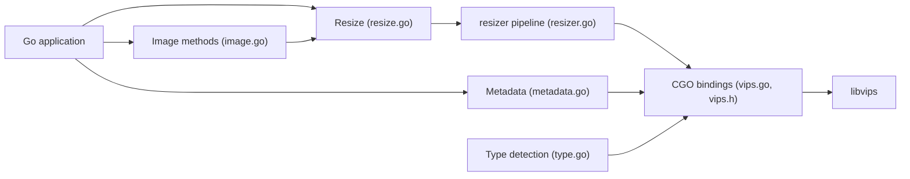

# bimg

> Go image processing library. It calls libvips through CGO.

## TL;DR

- Purpose: transform image byte buffers (resize, crop, rotate, watermark, convert format) and read image metadata.
- Trigger: a Go program imports `github.com/popsa-platform/bimg` and calls `bimg.Resize`, the `bimg.Image` methods or `bimg.Metadata`.
- Key services: the libvips C library (found with `pkg-config: vips`). No AWS services, tables, buckets or queues.
- Processing: image buffers in memory. Formats: JPEG, PNG, WebP, TIFF, GIF, PDF, SVG, ImageMagick buffers, HEIF, AVIF, JXL. Which formats work depends on how the installed libvips was built.
- Origin: a fork of `h2non/bimg`. The fork adds the EXIF `OffsetTime`, `OffsetTimeOriginal` and `OffsetTimeDigitized` fields.

## Architecture Overview

The caller passes an image buffer and an `Options` value. The pipeline in `resizer.go` loads the buffer, applies the steps that the options ask for, and saves a new buffer. Each step is a thin Go wrapper in `vips.go` around a C bridge function in `vips.h`.

## How It Works

1. `Image` methods build an `Options` value and call `Image.Process`. `Image.Process` calls `Resize` and stores the result as the new buffer of the `Image`.
2. `Resize` calls `resizer`. The function detects the type from the first bytes of the buffer and loads the image with libvips.
3. `resizer` fills default options (quality, compression, output type, colour space).
4. `resizer` rotates and flips the image. It uses the EXIF orientation unless `NoAutoRotate` is set.
5. `resizer` computes a scale factor. For JPEG and WebP it reloads the image with shrink-on-load when the integer shrink is 2 or more.
6. `resizer` scales, crops, embeds, extracts or trims the image.
7. `resizer` applies blur, sharpen, text and image watermarks, background flatten, gamma, brightness and contrast, when the options ask for them.
8. `resizer` converts the colour space, applies the ICC profile options, and encodes the output with the saver for the output type.

More detail: [.claude/docs/architecture.md](.claude/docs/architecture.md).

## Configuration

The library reads two environment variables, both in `Initialize` (`vips.go`). All other settings are `Options` fields or package functions.

| Variable | Default | Description | Required |
|----------|---------|-------------|----------|
| `VIPS_CONCURRENCY` | unset | When empty, bimg sets the libvips thread concurrency to 1. When set, bimg leaves the libvips value unchanged. | No |
| `VIPS_TRACE` | unset | When not empty, bimg enables libvips operation cache tracing. | No |

Package settings in code:

- `SetMaxsize(n)`: maximum width or height of an extract or smart crop. Default 16383.
- `VipsCacheSetMaxMem(n)` and `VipsCacheSetMax(n)`: libvips cache limits. Defaults 100 MiB and 500 operations.
- `Quality`: default JPEG quality 75.

## Dependencies

- System: libvips development headers, found by `pkg-config` (`#cgo pkg-config: vips`). A C compiler is required, because the package uses CGO. `Dockerfile` builds libvips and libheif for CI.
- Go: `go 1.25.2` in `go.mod`. There are no `require` entries, so the package has no Go module dependencies.
- Internal services and `pkg.*` packages: none.

## Related Repositories

- `h2non/bimg`: upstream project of this fork.
- `libvips/libvips`: the C library that does the work.
- `h2non/imaginary`: an HTTP service that is built on bimg.
